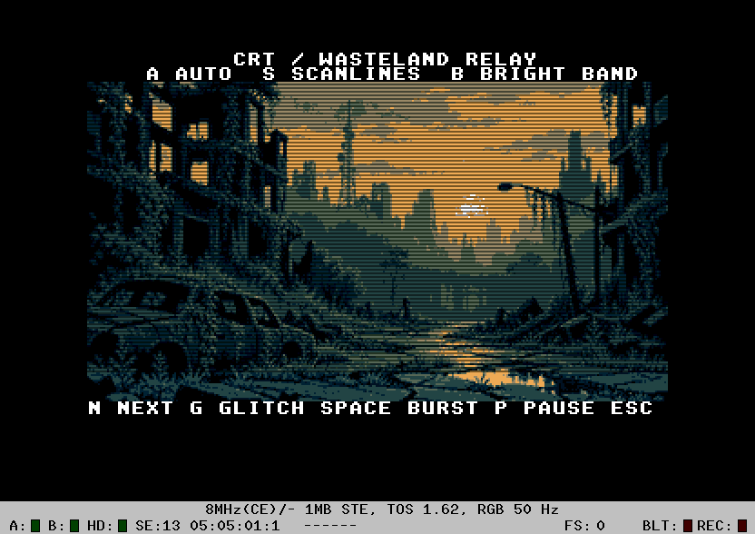
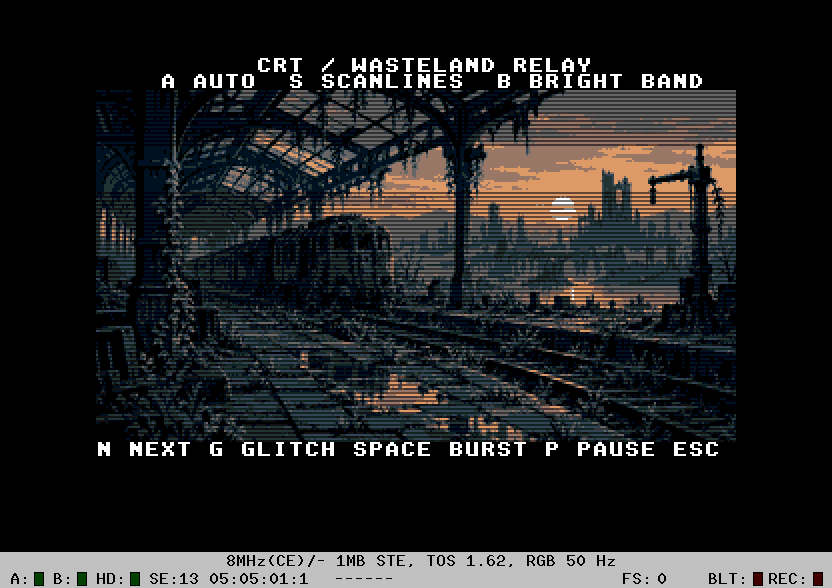

# CRT — Wasteland Relay

`CRT.PRG` is a standalone GodLib **Atari BLiTTER** example, tested on STE,
68000 at 8 MHz, RGB PAL 320x200, 1 MiB, German TOS 1.62.
It alternates two newly generated post-apocalyptic scenes with CRT scanlines, a moving
22-line bright band, brief synchronization jitter and torn image strips.
All runtime raster work is 68000 ASM; C handles lifecycle, input and commands.

```sh
make
make run
```

The PRG embeds all assets. `make assets` regenerates them using Python/Pillow
and local ABC2. `make debug` provides `analysis/CRTDBG.PRG` for the harnesses.
The `TOS` Makefile variable can override the default German TOS path.
A machine without a BLiTTER is rejected before the example opens its screen.

## Controls

| Key | Action |
| --- | --- |
| N | Switch picture: brighten/squash to a thin line, fade out, then open the next picture |
| A | Toggle automatic occasional jitter/tearing; on by default |
| Space | Trigger one ten-frame tearing burst |
| G | Toggle continuous tearing for demonstration/profiling |
| S | Toggle dark alternating scanlines |
| B | Toggle the moving bright band |
| P | Pause animation parameters |
| Esc | Restore TOS and exit |

Startup plays the reverse TV power effect: dim short line -> thin bright line
-> full picture, with its palette returning from overbright to normal. `N` turns the television off, swaps the image/palette on black and turns
it on again; subsequent presses alternate the two pictures. Each direction has
22 stages, two VBLs per stage (about 0.88 seconds). Image compression itself
uses only 11 heights (about 0.44 seconds). `N` is ignored during a
transition; `P` pauses interference parameters, not the TV power sequence.
The footer remains at X=0 and is included in the squash with the whole screen.

The first automatic burst is scheduled after 120 updates. Later bursts last
8–11 updates and occur after waits of 200–455 updates. Small +/-1px horizontal
jitter lasts 2–3 updates. Strong tearing varies each 16-row strip from -7 to
+8 pixels horizontally and shifts image sampling -1..+2 pixels vertically.
The bright band advances 3 lines/update; its cycle includes space above/below
the picture. Pausing freezes its position and image-shift commands.

## Artwork and palette

The [new source image](assets/postapoc-source.png) was made using built-in
image_gen. The [complete prompt](assets/generation-prompt.txt) is preserved.
[ABC2 provenance](assets/provenance.json) records the conversion parameters.
[Eight-colour preview](assets/postapoc-8col.png) shows the undimmed image.

The [second source](assets/postapoc2-source.png) shows an abandoned railway
station. Its [prompt](assets/generation-prompt2.txt), [ABC2 conversion](assets/provenance2.json)
and [eight-colour preview](assets/postapoc2-8col.png) are included as well.

ABC2 converts the art to **eight STE colours without dithering**, with black
at index 0 and white reserved at index 7. The image viewport is X=0..319,
Y=16..191; controls occupy the remaining rows. Planes 0..2 store image colours.
Plane 3 selects a second, half-bright palette bank. Alternating image rows are
dimmed except inside the bright band. Black remains black in both banks.
ST palette hardware has fewer intensity steps; no Falcon features are used.

There are no raster interrupts or per-scanline palette changes. The palette is
set at initialization, at the black scene swap, and during transitions using
VBL-synchronized precomputed palettes. Non-black colours become very bright as
the image collapses; both black palette entries remain black. The normal CRT
brightness pattern lives in plane 3.

## ASM implementation

The effect adapts the ideas in `superhex_ste/src/main.c:891` (`rbt_band`) and
its RBT drawing loop, also examined in the SUPH04 executable. This version uses
three picture planes plus one independent brightness mask, rather than the
original monochrome logo on two planes. It does not open the bottom border.

`Crt_ImageUpdate` stores previous X shifts/Y shift **separately for both pages**.
It skips unchanged strips. Adjacent strips with an identical new X shift
coalesce into a single run, copied in three blits, one per picture plane.
Steady frames therefore do not copy the whole picture. The BLiTTER uses SKEW
and FXSR for exact pixel shifts, source stride 44 and destination stride 160.
It runs in shared mode with a busy/restart wait and interrupts enabled.

The prepared source contains three separate planes, each 22 words by 204 rows
(26928 bytes total). Zero guard words and rows support the extra FXSR reads
and prevent a shifted row from wrapping into the adjacent row. Viewport borders
reveal black. Screen coordinates and the brightness mask stay fixed while
sampling of the picture shifts vertically.

`Crt_MaskUpdate` computes old-minus-new and new-minus-old bright-band intervals.
Only changed odd rows are filled by an unrolled, word-based ASM kernel. A
scanline toggle updates all affected odd rows once. Each page's complete
history occupies 28 bytes. Even rows, captions and the clean Back canvas are
preserved. No per-pixel C drawing, dynamic allocation in the frame loop or
per-frame full-screen restore is used.

## TV power transition

The new `crt_tv.s` adapts the centred squash and collapsing bright line from
`NIEZW/NIEZW.TOS`. The current version follows the supplied NIEZW screenshots: the image brightens
while collapsing, reaches a two-pixel line, then a short horizontal afterglow
fades away. There is no round dot. Opening uses the same stages in reverse. Offline row maps replace the original general
32-bit signed division inside the visible-row loop. The renderer uses MOVEM
row copies, per-page row reuse, and clears only newly uncovered strips.
No raster interrupts or screen-base tricks are needed.

See [binary analysis and optimization notes](analysis/NIEZW-TV.md), including
TEXT/file offsets and the original binary hash. The original NIEZW is unchanged.
The renderer adds 3230 bytes of step/map/palette data, 800 bytes of per-page row history
and four bytes of height history; it reuses Back instead of allocating another
32000-byte snapshot. Both embedded pictures have independent ABC2 palettes.

[Animated native Hatari preview](analysis/tv-transition.gif).

## Verification and profiling

```sh
make debug
python3 analysis/verify-hatari.py
python3 analysis/verify-tv.py
python3 analysis/profile.py
python3 analysis/profile-tv.py
```

The native harness compares all 32000 VRAM bytes with an independent scalar
reference. It covers every X shift -7..+8, every Y shift -1..+2, uniform and
independently torn strips, both pages, bright-band clipping/wrap, scanline
toggles and unchanged Back. It also exercises controls and clean TOS exit.
See [verification results](analysis/verification.json). An additional
[180 TV transition frames](analysis/tv-verification.json) cover every off/on
stage on both pages, both pictures, displayed-page palette synchronization and a permanently black background, correct normal
rendering after swapping the source, and clean exit.

HRDB measurements separate C command generation, ASM wrapper, image blits and
mask updates. Blitter execution and busy/restart waiting are included in the
rendering cost. VBL/input/OS overhead and initial asset/page copies are excluded.
The frame budget used is 160000 cycles at 8 MHz / 50 Hz. Continuous tearing is
intentionally profiled separately from the ordinary, mostly quiet automatic
mode. These are representative averages, not a bound for every random sequence.
The preceding build measured the unchanged normal renderer at **3.00%** for the moving band without jitter, **7.63%**
for automatic occasional disturbances, and **57.44%** for continuous tearing.
The TV transition averages **21.51%** over its 90 updates; scene preparation
and VBL/input overhead are excluded, and the average is not a worst-case bound.
See [TV CPU results](analysis/tv-profile.json), [CPU results](analysis/profile.json) and [CPU.md](CPU.md).




