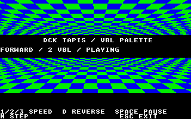

# DCK TAPIS — palette animation in VBL

Original **TAPIS3_4** ceiling/floor picture and **TAPIS.COL** palettes from DCK.
The original 320×200 four-plane bitmap is embedded without resizing, remapping
or recolouring. GodLib draws the legend once in its unused black rows. During
animation the pixels stay still; a small 68000 callback writes the sixteen
palette registers in VBL.

| Key | Action |
|---|---|
| 1 / 2 / 3 | Advance the palette every 1 / 2 / 4 VBLs |
| Space | Pause / resume |
| D | Reverse the cycle |
| N | Pause and advance one palette in the current direction |
| Esc | Detach the callback and restore TOS |

Default: forward, one phase every **two VBLs** (25 palette changes/s at PAL
50 Hz). A fourteen-phase cycle takes 0.56 seconds; the other speeds take 0.28
and 1.12 seconds. The main loop stays at 50 FPS in the measured windows.
The palette keeps animating even when the main loop is held for verification.

## Original assets and adaptation

Sources are preserved under `source/`; `assets/source.json` records hashes.
`TAPIS.COL` has capacity for 275 complete palettes, not 275 useful animation
frames. Record 0 is the saved picture palette, identical to record 1 and the
PI1 header. **Records 1..14 form the cycle**; records 15..274 are zero-filled.
The example uses those fourteen original records unchanged. Index 0 stays
black; index 1, unused by the artwork, supplies the legend's white.

DCK's VBL code at TEXT `$2C4A/$2E16/$2EA4` phases palette data for its raster
reloads at `$2F2A–$31BA`. This example deliberately plays complete records
over time in VBL. It is a temporal adaptation of the original palette data,
not the original per-scanline raster/overscan presentation. See
[the DCK/LCK audit](../../DCK/EFFECTS-AUDIT.md) and
[recovered ASM](../../DCK/extracted/effects/vbl-rasters-and-borders.s).

`Tp_Vbl` is a normal GodLib `Vbl_AddCall` callback ending in `RTS`. It snapshots
one atomic control word, handles direction/pause/step/countdown, and writes
eight longwords to `$FFFF8240..$FFFF825C`. It uses only volatile ABI registers
D0/D1/A0, preserving the callback iterator D7/A6. It installs no interrupt
vector or Timer B owner and requires no BLiTTER. C owns setup, input and the
occasional status-line update, with no per-frame bitmap drawing or copying.

Pause holds the phase while the callback continues to write that palette
each VBL. N uses a toggled command bit so exactly one step is consumed from
each submitted command. Installation/removal uses saved/restored IPL 7; the
callback is detached before Screen/Platform teardown.

## Build and evidence

```sh
make
make run
make assets             # Pillow: native bitmap/palettes and source preview
make check              # actual VBL records, palette and lifecycle checks
make profile            # profile the shipped PRG in Hatari-HRDB
```

Uses local GCC ELF, vasm, GodLib and libcmini with matching ABI. Python test
tools import the installed `hatari-debugging` helpers. German STE TOS 1.62 and
1 MiB are the default; `TOS` overrides the ROM path. HRDB defaults to port 56001;
`TP_HRDB_PORT` can select an isolated forwarded port. Debug PRGs, symbol files
and RAM dumps are kept under `/tmp`.

The ASM object contains **280 bytes of code**: a 178-byte VBL routine including
its period helper, plus the 102-byte startup picture copier. Embedded data is
**32456 bytes**: the original bitmap, fourteen palettes and an eight-byte period
table. GodLib owns its ordinary display pages and Back buffer; there is no
frame cache or runtime image allocation beyond those screen buffers.

[CPU.md](CPU.md) describes actual shipped-PRG CPU measurements and ST/STE
release tests. `verification.json` records 3072 VBL snapshots and 28 manual
steps. `palette-cycle.gif` is a decoded native page recoloured with the original
sequence at the default speed, rather than a video recording of Hatari.


