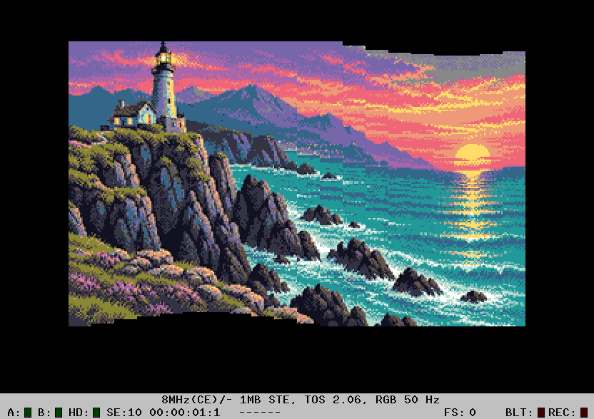

# FLAGWAVE — 68000 assembly

`FLAG.PRG` waves our coast picture as twenty vertical 16-pixel strips, on an
ordinary ST or STE. The artwork is the approved ABC2 STE 16-colour conversion,
without dithering; an ST displays its coarser palette interpretation.
No blitter, raster interrupt, bit shifting or large preshift cache is used.

- A: automatic sine wave (starts in this mode).
- M: mouse-controlled wave, matching the original STOS delay queue.
- Move the mouse vertically: `(clampedMouseY - 100) / 10`, rounded toward zero.
- 1 / 2 / 3: automatic amplitude 4 / 10 / 16 pixels; default 10.
- S: automatic phase speed 2 / 4 / 8 per VBL; default 2.
- Space: pause/resume; N: pause and advance one step; Esc: return to TOS.

Mouse mode uses all 21 entries of the original queue: draw entries 0..19,
shift entries 1..20 left, then put the current mouse displacement into entry
20. Changes first appear in the rightmost strip two draw calls later and
travel left. A stopped mouse eventually makes all strips align.

Automatic mode is an addition: strip x uses
`round(amplitude * sin((phase + (19-x)*12) * 2*pi/256))`.
The 12-unit spatial delay makes a visible wave across the whole picture even
at slow animation speed. Its temporal phase advances by elapsed VBLs, so
motion retains its speed if rendering misses a frame. This mode is not the
literal STOS mouse FIFO with a sine plugged into it; the original has no sine.

## Renderer

All runtime image copies, edge clearing, offset preparation and mouse-queue
shifting are in `flagwave_s.s`. C handles setup, input and frame pacing.

The source is rearranged offline into 20 contiguous 1600-byte columns. This
uses exactly 32000 pixel bytes, with no pixel duplication. A shared 1600-byte
unrolled copy routine copies two longwords per row. A jump into that routine
clips the top/source rows; adjusted destination addressing clips the bottom.
An assembly-time check enforces its eight-code-bytes-per-row jump stride.

Only the exposed top/bottom of each strip is cleared. Columns that retain the
same displacement on their current screen page are skipped completely. Each
page has its own 20-word history; this is essential with double buffering.
After both pages are drawn, a paused/static picture needs only offset checks.
Each updated column writes all 200 destination rows through image plus clear
operations, regardless of the preceding frame, so no stale strips remain.
The ASM preserves GCC's complete d2-d7/a2-a6 callee-save registers.

`assets/COAST.PI1` is a local master copy. `tools/prepare.py` produces the
column-major bitmap, unchanged palette and three signed sine tables.
The Makefile refreshes the copy from `../wipe/COAST.PI1` when it changes.

## Build and checks

```
make debug
python3 analysis/verify-hatari.py st-2.06
python3 analysis/verify-hatari.py ste-2.06
python3 analysis/verify-hatari.py ste-1.62
python3 analysis/profile.py
```

The full-frame reference independently implements clipped rectangle copies
into a freshly cleared framebuffer. Tests exercise every displacement -16..16,
positive/negative/zero edges, both page histories, sinusoidal amplitudes,
speed changes, pause, single-step, the original mouse FIFO and clean exit.
Mouse coordinates are injected into the actual IKBD field read by the program;
the stock Hatari control protocol has no mouse-motion injection command.
The initial screenshots are captured before debugger stops.

## Original

A.C. Porritt's `Atari_ST_Sources/STOS/A. C. Porritt/STOSSER 8/FLAGWAVE.ACB`
is a tokenized STOS BASIC program, not a native extension function.
`analysis/original-basic.txt` records its decoded listing: twenty SCREEN COPY
calls, a CLS each frame, a 21-element mouse delay queue and a screen swap.
This sample keeps the mouse behavior, but replaces full-screen CLS with
clearing just the visible edges and adds independent page reuse and sine mode.

The binary is named `FLAG.PRG` to avoid the known long-autostart-name issue
seen in this workspace's Hatari/TOS 1.62 setup. No original files are modified.
Measurements and verification below are emulator evidence, not physical-ST
benchmarks or a timing comparison with a running STOS interpreter.

Verification passed **54 complete frames** across ST/TOS 2.06, STE/TOS 2.06
and STE/TOS 1.62, all at 8 MHz with 1 MB RAM. Every frame byte agrees with
the reference; mouse FIFO, controls, both page histories and exit pass.

## Measured CPU cost

Hatari-HRDB, ordinary ST / 68000 at 8 MHz / PAL / 1 MB RAM / TOS 2.06.
The automatic phase speed is the default 2 per VBL.

| Mode | ASM time per frame | PAL frame budget | Actual update rate |
|---|---:|---:|---:|
| Automatic ±4 px | 6.50 ms | 32.4% | 50 FPS |
| Automatic ±10 px (default) | 15.70 ms | 78.4% | 50 FPS |
| Automatic ±16 px | 22.60 ms | 112.8% | 25 FPS |
| Mouse stationary, after queue settles | 0.29 ms | 1.5% | 50 FPS |
| Paused automatic wave, after both pages settle | 0.37 ms | 1.8% | 50 FPS |

These counts include offset preparation, row copies, edge clearing, column
reuse checks and (in mouse mode) the FIFO shift. They exclude the C input/main
loop, OS/VBL service and startup conversion. FPS is measured from frame and
VBL counters, not inferred from the profiler's cycle totals. Measurements use
a fresh emulator per mode; raw instruction captures are locally available.

The default wave reuses about 7.5 of 20 columns per frame and copies 12.5.
At amplitude 16, slower frames advance farther in phase and reuse only about
1.9 columns per frame, so it settles around 25 FPS. Moving the mouse can also
make many columns dirty; the stationary-mouse figure is not a general bound
for arbitrary gestures. Faster S settings increase the work as more columns
change. Only small newly exposed edges are cleared; the screen is never fully
cleared during animation.


