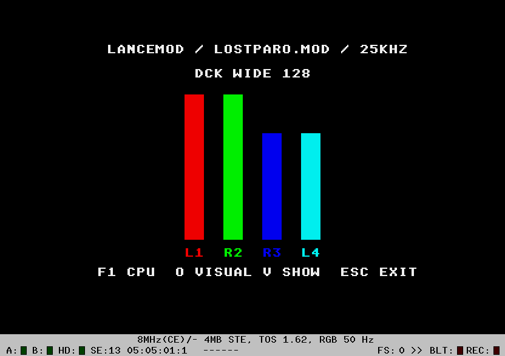

# Five DCK MOD bar layouts

LanceMod, LeonardMod (25 and 12.5 kHz) and Wizzcat now have **ten** visualization
modes under `O`. After the original bars, four scopes, ICE XY, stereo and mono
come these five DCK-inspired layouts:

| Mode index | Layout | Geometry at level 16 |
|---|---|---|
| 5 | DCK narrow 32 | Four 8×32 vertical bars. |
| 6 | DCK narrow 64 | Four 8×64 vertical bars. |
| 7 | DCK wide 64 | Four 16×64 vertical bars. |
| 8 | DCK wide 128 | Four 16×128 vertical bars. |
| 9 | DCK horizontal | Four 256×10 horizontal bars. |

`V` hides/shows the selected mode; `F1` retains the existing **audio replay**
timing stripe. It is not a marker measuring the new renderer. `Esc`/Space
exit as before. Keep the example's MOD file beside its PRG.



## What is adapted

DCK TEXT $3788–$3A64 contains five four-channel bar layouts with falling
counters. The shared `dckvis_s.s` adapts their geometry to the existing GodLib
**0..16 retrigger-activity levels** and uses independent per-page deltas.
It does not add amplitude/RMS analysis or change player timing. The current
Lance/Leonard/Wizzcat activity level still represents time since instrument
retrigger, rather than the channel's actual current volume.

Each channel draws into its own plane: red L1, green R2, blue R3 and cyan L4.
Vertical bars start at X=104/136/168/200 and end at Y=168. Wide bars straddle
two planar word groups using two byte writes; narrow bars write one byte.
Horizontal bars start at X=32, Y=56/84/112/140 and update 16-pixel word blocks.
The destination is fixed ST-low, 320×200, 160-byte stride.

The old/new level determines only the rows/blocks that must be filled or
erased. Identical levels do not touch pixels. No whole-screen copy occurs
in ordinary drawing; existing mode/hide transitions restore each display
page once. The old four-word activity history is reused, with no extra
per-page allocation. Assembly plus constant tables/palette/function pointers
occupies **580 bytes**. No new heap buffer or frame cache is introduced.

Lance's object is shared by Leonard and Wizzcat through their existing
cross-example build pattern. Library sources and music replay are unchanged.

## CPU at 8 MHz

Hatari-HRDB, STE MC68000 8 MHz, PAL RGB, 4 MiB, German TOS 1.62. The table is
**renderer-only percent of a 160000-cycle PAL frame**, not total player CPU.
It excludes the activity getter, C conversion/dispatch, VBL waits, mode-change
copies, replay/mixer and OS wrappers.

| Style | Lance 25K | Leonard 25K | Leonard 12.5K | Wizzcat |
|---|---:|---:|---:|---:|
| Narrow 32 | 0.65% | 0.70% | 0.68% | 0.96% |
| Narrow 64 | 1.08% | 0.77% | 0.85% | 1.17% |
| Wide 64 | 1.20% | 1.05% | 1.30% | 1.35% |
| Wide 128 | 1.85% | 1.88% | 1.79% | 2.81% |
| Horizontal | 0.73% | 1.06% | 0.93% | 0.93% |

Lance/Leonard used their included LOSTPARO.MOD; Wizzcat used QUICKIE.MOD.
Each window captured 890–1102 completed frames. The combined profile contains
**20031 frames**, and normal-frame counters around the windows recorded
**29287 updates with no missed VBLs**. The new modes maintained 50 FPS in
these emulator tests. They are not physical-hardware timing measurements.

These are song/passage-dependent averages. Different activity patterns cause
different delta sizes; the figures are not a comparison of player or mixer
speed and are not worst-case guarantees. Exact counters and build hashes are
in [dck-results.json](dck-results.json).

## Verification and reproduction

An independent native fixture checked **240 complete frames**, 48 per style,
on alternating buffers, with 32004 bytes compared per frame including guard
words. Cases cover every 0..16 level, growth/shrink, zero/full scale,
unchanged levels and independent channel patterns. All bytes matched.

The integrated checks cycled all ten modes in all four builds, tested V hide
against the clean background on **both** display pages for every DCK layout,
restored display, wrapped O back to the original mode and exited cleanly.
Leonard's VBL callback was confirmed detached on exit. Replay ownership and
its library objects were not modified.

From `godlib.spl`:

```sh
make -C lancemod debug
make -C leonard RATE=25 DEBUG_OUT=/tmp/LEODBG.PRG debug
make -C leonard RATE=12 DEBUG_OUT=/tmp/LEO12DBG.PRG debug
make -C wizzcat DEBUG_OUT=/tmp/WIZDBG.PRG debug
python3 lancemod/tools/verify_dck.py
python3 lancemod/tools/profile_dck.py
```

The scripts use local hatari-debugging helpers. HRDB defaults to port 56001;
`DCK_MOD_HRDB_PORT` overrides the client port when the emulator is mapped to
match. The recorded run used an isolated port mapping. Debug binaries,
GEMDOS drives and full framebuffer dumps stay in temporary directories;
previously removed `analysis/` directories are not recreated by these commands.
