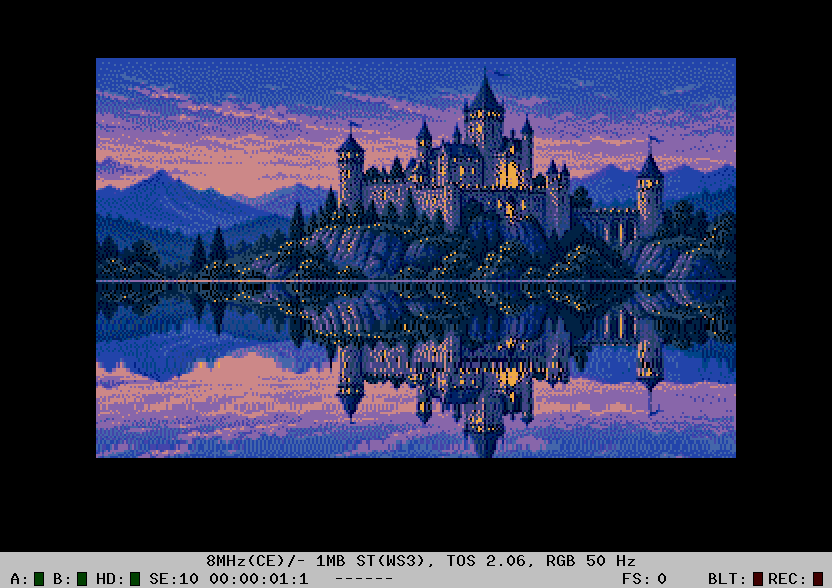

# Missing Link REFLECT

`REFL.PRG` reflects the castle above the lake, using the actual Missing Link
STOS `REFLECT` algorithm ported to GodLib in 68000 assembly.

- Space: pause/resume; N: pause and advance one original call; Esc: exit.
- ST or STE, 320x200, 16 colours, 1 MB RAM, no blitter or raster interrupt.
- 40 calls per animation cycle; default one call per displayed frame.

The algorithm copies full-width source rows backwards using a repeating
0..4-line step table. Phase advances every second call. It compresses the
reflection vertically by roughly two; there is no horizontal distortion or
palette tint. The exact original four MOVEM groups per row are preserved.

To fill the lake at Y=112..199, `tools/prepare.py` stretches only castle rows
0..110 into a separate 200-row source. Nothing in the old painted water is
sampled. The upper display stays unchanged. `assets/CASTLE.PI1` is the same
palette/image as [water](../water/README.md); original generated PNG and prompt
are retained in that example. `TOP.PI1` has a black lake before the runtime
reflection is drawn, and `SOURCE.BIN` contains only the prepared castle.

The reusable API is `Graphic_Reflect(sGraphicReflect*)` in
`godlib/graphic/reflection.h`. See the [library notes](../../godlib/docs/reflection.md)
for exact endpoints, height, clipping and the original guard-row quirk.

## Rebuild and verification

```
make -C ../../godlib
make debug
make oracle
python3 analysis/verify-original.py
python3 analysis/verify-hatari.py st-2.06
python3 analysis/verify-hatari.py ste-2.06
python3 analysis/verify-hatari.py ste-1.62
python3 analysis/profile.py
```

`analysis/missing-link-reflect.s` is a real disassembly of LINK2.EXR, not the
GodLib port re-disassembled. `missing-link-addresses.json` records file/TEXT
mapping and SHA-256. Original STOS BASIC's REFLECT is EXT R:$86, dispatching to
TEXT $15da; the native core begins at $1642. The analysis script extracts the
original 68000 bytes with their PC-relative tables and patches only the STOS
return into RTS, so the oracle executes both implementations on the emulator.
The original local extension is never changed.

The oracle passed **400 calls** (10 coordinate cases × all 40 states):
all 32000 destination bytes and the animation state agree with the original.
Cases include the historical one-row source underrun, using a readable guard
row. The tested sample source stays entirely inside its allocated buffer.

`analysis/original-results.json`, `results-*.json` and `profile.json` contain
reproducible target results. These are emulator measurements, not hardware
benchmarks or a claim of running the entire original STOS interpreter.

## CPU cost

Hatari-HRDB, ST 8 MHz / 1 MB / TOS 2.06, 88 reflected rows:
69,048 cycles per call on average, **8.63 ms / 43.1% of a PAL frame**.
The sample maintains approximately 50 updates/s. This includes the public ASM
entry, coordinate setup, phase update and all row copies; it excludes the main
loop, input and VBL overhead. It deliberately retains the original copy kernel,
without per-page row reuse or an alternative faster renderer.

## Target verification

39 full-frame checks passed across ST/TOS 2.06, STE/TOS 2.06 and STE/TOS 1.62
at 8 MHz with 1 MB RAM. Checks cover both screen pages, original phase/state,
unchanged castle, pause, single step, phase wrap and five seconds after exit.

The release uses the short name `REFL.PRG`. The initial `REFLECT.PRG` name
showed an error in ROM after the program had returned under Hatari/TOS 1.62;
the same compiled effect under the shorter name passes, consistent with the
existing [palsplit autostart filename regression](../palsplit/README.md).
No renderer or interrupt behavior was changed to work around that issue.



## Artwork conversion update

Generated scene artwork now uses **ABC2, STE RGB444, without dithering**.
See the [shared artwork guide](../tools/ARTWORK.md) for reserved colours,
regeneration, shared copies and validation. Snowfall retains eight background
colours to leave its snow bitplane free. Older ST screenshots and CPU results
above refer to their original artwork revision.
