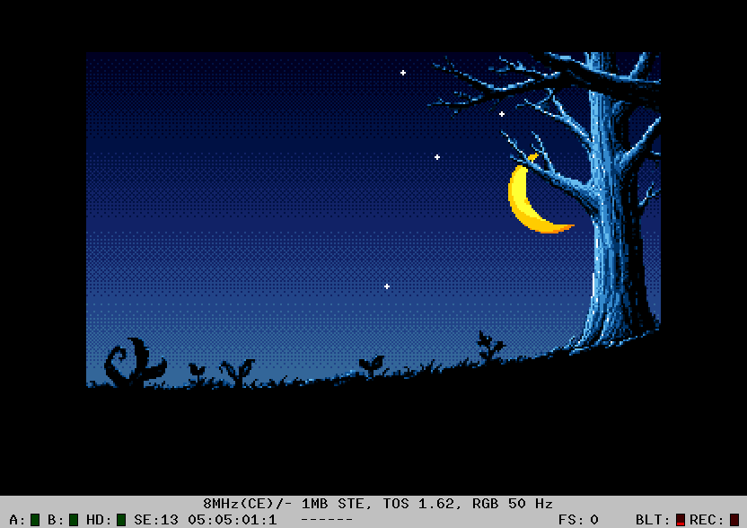

# Sprite behind a foreground mask

A 48x48 orange/yellow crescent sprite rises diagonally from the bottom centre to the upper right
of the supplied night scene. The grass, tree trunk and branches hide it. The
320x200 ST-low picture uses one shared 16-colour STE palette. Its sky gradient
is stored in the bitplanes with ordered dithering; black is opaque index 0. Runs on ST/STE
with 1 MiB RAM. ST displays the palette's RGB333 subset.

```
make
make run
```

Output: `MOON.PRG`, standalone, with all assets embedded.

- **P:** pause/resume.
- **Space:** restart from the bottom.
- **Esc:** return to TOS.

The moon starts with its top-left corner at (136,200), fully below the screen,
and continues past the upper-right edge to (334,-94), until the entire moon
is off-screen. The animation holds briefly at both ends and repeats.
Positions in the path file are sprite top-left coordinates, not centres.

## Dithered sky, without rasters

The background matches the approved static preview. Five sky shades (indices
1,2,3,4,5) form a navy-to-blue gradient, blended with a 4x4 Bayer pattern.
The scene uses **15 of the 16 palette entries**:

| Indices | Use |
| --- | --- |
| 0 | Opaque black foreground |
| 1..5 | Dithered sky gradient |
| 6..11 | Tree highlights and star colours |
| 12 | Unused; currently contains a reserved dark orange |
| 13..15 | Orange/yellow crescent |

The background uses 12 colours (0..11); the moon adds three. Stars reuse
indices 8, 10 and 11. All colours share the same fixed 16-entry palette.
The gradient costs no additional per-frame drawing, palette writes or raster
interrupts: the ordinary 32,000-byte background already contains it.

Black at index 0 is opaque in the scene. Sky uses indices 1..5. The separate foreground mask
alone determines which pixels hide the moon/stars. Background restoration
copies the original dither pattern, on both logical pages.

## Twinkling stars

The four original static star points are replaced in place by four animated
stars; no additional stars are scattered over the scene. Each uses three
16x16 sprite frames: small, medium and large, played small -> medium -> large
-> medium -> small. The cycle is 192 VBLs, with different offsets for each
star, so their flashes do not synchronize. The large cross is 13 pixels tall.
All frames share the scene's white and blue colours; the moon palette is intact.

Stars are normal GodLib `sSprite` objects. `Screen_Logic_Blit_Clip` restores
each fixed star rectangle from the clean background, and
`Screen_Logic_DrawSprite_Clip` draws its current animation frame. Both use
GodLib's selected CPU/blitter backend. No additional star drawing or restore
ASM is used. The masks include the fixed foreground at each location, so a
large flare cannot paint over a nearby branch. The twelve masked frames total
1,920 bytes. Restore happens before moon restoration; stars are drawn before
the moon, preserving the correct layering. P pauses both animations and Space
restarts both.


## Assets and ABC2

`assets/source.png` is the supplied original. `prepare.py` resizes it with
nearest-neighbour sampling, classifies its flat sky and repairs isolated bark
holes while preserving the genuine fork opening. The corrected silhouette is
independent of the colour conversion. The four original star locations are
cleared and replaced by animated sprites.

The exporter applies the curated palette approved in the preview, remaps tree
pixels to its foreground shades, and generates the ordered sky dithering
only outside that silhouette. `assets/scene.png` is the exact indexed 4-bit
colour image used by the program.

ABC2 generates the **8,000-byte one-bit foreground mask** from the separate
black/white `assets/foreground-source.png`, with
`-atari -mask -bpc 4 -remap 0 0 0`. `-bpc 4` must follow `-mask` to override
ABC2's default five-plane input setting for Atari validation; the output has
one bitplane. Each result bit is checked against `assets/FORE_REF.BIN`:
**0 = sky, 1 = tree/grass**. The runtime colour image cannot be used to generate
this mask, because sky pixels use nonzero palette entries. The opaque
black trunk (palette index 0) and all previously repaired bark holes remain masked.

The moon is a procedurally drawn pixel-art crescent with subtle surface shading,
formed by subtracting an offset disc and sharing the scene palette. Its outside pixels are transparent index 0. Sixteen shifted
phases are generated offline, occupying **30,720 bytes**. Each phase contains
48 rows of four groups: one shape-mask word and four colour-plane words.
There is no runtime per-pixel C drawing or shifting.

```
python3 prepare.py
make debug
python3 analysis/verify-hatari.py
```

## Masking in ASM

C handles the animation position, input, clipped dimensions and page selection.
`Moon_Draw` prepares a work sprite in 68000 assembly; it does not draw the moon
into screen RAM. It intersects the sprite silhouette with the scene mask:

```
visible = moon_shape & ~foreground_mask
work_mask = ~visible
work_plane = moon_plane & visible
```

`work_mask` uses GodLib's preserve-mask convention: 1 keeps the background, and
0 clears it before the sprite's colour bits are ORed in. Hidden colour bits
must be zero as well as masked; otherwise GodLib's OR pass would damage the
foreground. Both operations are performed word-by-word in ASM.

The work arrays back a normal `sSprite`, padded to 64 pixels wide, with four
colour planes and one stored mask word per group. The descriptor uses
`mMaskPlaneCount=4`, matching GodLib's standard four-plane masked sprites.
The working colour/mask arrays total **1,920 bytes** in BSS. Source phases
remain immutable; a fresh work sprite is prepared at each position.

C then calls **`Screen_Logic_DrawSprite_Clip`**. `Graphic_SetBlitterEnable`
enables GodLib's blitter renderer when hardware is present (normally STe);
a plain ST automatically uses GodLib's CPU sprite renderer. The work sprite is
aligned to the destination word; its selected source phase preserves the moon's
pixel-accurate position. Only the visible top/bottom rows are prepared, while
GodLib clips the padded work sprite at the right screen edge. The tree is not
redrawn after the sprite.

Each logical page has its own previous dirty rectangle. `Moon_Clear` restores
only that word-aligned rectangle from the clean background using word/longword copies.
The bottom and top are clipped to visible rows; top clipping skips the
corresponding sprite-source rows. At the right edge only destination groups
inside the screen are processed. The dirty record stores the clipped width
and height independently for each page. A wholly off-screen moon draws
nothing, after its previous footprint has been restored. Strides are explicitly
160 bytes for colour and 40 bytes for the foreground mask.

The target verification compares full 32,000-byte framebuffers with an
independent pixel reference. It checks all sixteen horizontal phases, both
pages, the bottom entry, opaque black foreground, visible moon, grass/tree
occlusion, unchanged clean background, restart, pause/resume and clean TOS exit.
Results and a captured emulator preview are in `analysis/`.

Recorded verification: **258 full-screen comparisons**, including star
expansion/shrinking transitions, top/right
clipping and the fully off-screen endpoint, on ST/TOS 2.06 (GodLib CPU sprites) and
STE/TOS 1.62 (GodLib blitter sprites), 8 MHz, 1 MiB, with zero missed VBLs. Full displayed-pixel and palette comparisons use
RGB333 on ST and RGB444 on STE. See `analysis/results.json`.

The bark-mask regression repairs **450 pixels** misclassified as sky. The solid
trunk core x=286..296, y=40..144 previously had 167 transparent pixels and now
has none. The worst affected animation position was path index 591, where 41
moon pixels could leak through bark. The target tests cover that position and
nearby frames explicitly. See `analysis/mask-audit.json`.


